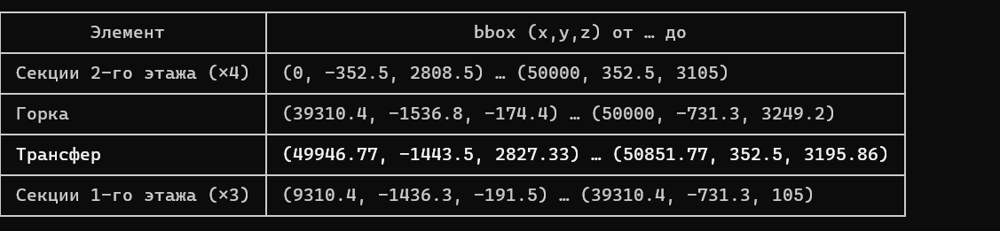
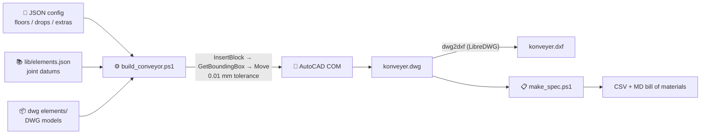

# 🏭 RobBox CAD — Conveyor System Designer

> 🇷🇺 [Русская версия (Russian version)](README.ru.md)

**Automated assembly of 3D multi-level conveyor models from a component library: a JSON config in — a ready DWG/DXF and bill of materials (BOM) out.**


---

## ✨ Features

- **🏗️ Serpentine conveyor assembly over N floors** — horizontal sections, chutes ("gorkas"), 90° transfers, sorting zones and any third-party models placed automatically from a JSON config
- **🎯 Self-correcting insertions** — every element is measured with `GetBoundingBox` after insertion and repositioned with **0.01 mm tolerance**; INSBASE offsets, base points and staging shifts of any new model are compensated automatically
- **🔗 Automatic joint anchoring** — receiver lines snap their leading face to the chute exit face; the chute crown is anchored to the transfer table plane
- **📋 Bill of materials (BOM)** — from any DWG: CSV (UTF-8, opens in Excel) + Markdown summary by element type, total lengths and floor lines
- **📚 Extensible element library** — `probe_element.ps1` measures a new DWG model and registers it in `elements.json`
- **🖥️ GUI (WPF)** — a friendly shell with tabs: Assembly, Specification, Library, Scheme (XZ serpentine preview)
- **🤖 Claude Code skill** — the whole workflow is packaged in `.claude/skills/robbox-cad`; the agent builds a conveyor from a plain-language request (*"build a 4-floor serpentine"*)



---

## 🚀 Quick Start

### Option 1 — GUI (for users)

```bat
Prog\robbox_gui.cmd
```

Opens a window with four tabs:

| Tab | What it does |
|---|---|
| **Assembly** | Floors, drops, extra elements → JSON config → `build_conveyor.ps1`, live build log tail |
| **Specification** | Runs `make_spec.ps1` on a chosen DWG → CSV + MD |
| **Library** | Browse `elements.json`, probe new DWG models, edit datums (with backups) |
| **Scheme** | XZ preview of the serpentine before building |

### Option 2 — CLI

```powershell
# Build a conveyor from a config
powershell -File .claude/skills/robbox-cad/scripts/build_conveyor.ps1 -Config configs/serpentine4.json

# BOM for a finished DWG
powershell -File .claude/skills/robbox-cad/scripts/make_spec.ps1 -Dwg konveyer.dwg -Lib lib/elements.json -Out konveyer_spec

# Register a new element in the library
powershell -File .claude/skills/robbox-cad/scripts/probe_element.ps1 -Dwg "dwg elements/new.dwg" -Name new_elem
```

### Option 3 — Claude Code (AI agent)

The `robbox-cad` skill activates automatically. Just write, e.g., *"build a 3-floor conveyor, west drop, sorting zone on floor 1"* — the agent composes the config, runs the build, verifies joints by bounding boxes and reports a placement table.

---

## ⚙️ How It Works



### Key principles

1. **Never trust the first placement.** Insert → measure bbox → correct → re-measure. That is the self-correction loop.
2. **Datums, not eyeballs.** Joint points of each element (chute crown = transfer table plane, sensor bottom of a section = floor plane, etc.) live in `elements.json` and are calibrated to the reference master drawing, exact to the millimetre.
3. **Serpentine out of the box.** Floors stacked one above another, drops alternating east/west, axis Y-offsets of lines (−1083.761 mm) handled by baked-in formulas.
4. **VERIFY report.** After the build the script re-measures ALL insertions and reports `JOIN dx=0 dy=0` lines — any deviation > 0.5 mm is visible immediately.

---

## 📁 Repository Layout

```
├── Prog/
│   ├── robbox_gui.cmd              # GUI launcher (powershell -STA)
│   └── robbox_gui.ps1              # WPF shell
├── .claude/skills/robbox-cad/      # Claude Code skill
│   ├── SKILL.md                    # rules, datums, serpentine formulas
│   ├── scripts/
│   │   ├── build_conveyor.ps1      # conveyor assembly
│   │   ├── make_spec.ps1           # bill of materials (BOM)
│   │   ├── probe_element.ps1       # register an element in the library
│   │   └── render3d.ps1            # verification render (XY/XZ/YZ)
│   ├── lib/elements.json           # element library + datums
│   └── configs/                    # sample build configs
├── dwg elements/                   # DWG models (section, chute, transfer…)
│   └── convert/                    # dwg2dxf.exe, dwggrep.exe (LibreDWG)
├── dxf elements/                   # DXF versions of the models
└── konveyer.dwg / konveyer.dxf     # latest build result
```

---

## 🧩 Sample Config (4-floor serpentine)

```json
{
  "output": { "dwg": "konveyer4.dwg", "dxf": true },
  "elements_lib": "lib/elements.json",
  "floor_gap": 3000,
  "lines": [
    { "id": "floor4", "z": 9000, "y": 0,         "length": 50000, "element": "section" },
    { "id": "floor3", "z": 6000, "y": -1083.761, "length": 50000, "element": "section" },
    { "id": "floor2", "z": 3000, "y": 0,         "length": 50000, "element": "section" },
    { "id": "floor1", "z": 0,    "y": -1083.761, "length": 30000, "element": "section" }
  ],
  "drops": [
    { "upper": "floor4", "lower": "floor3", "side": "east", "gorka": "gorka", "transfer": "transfer" },
    { "upper": "floor3", "lower": "floor2", "side": "west", "gorka": "gorka", "transfer": "transfer" },
    { "upper": "floor2", "lower": "floor1", "side": "east", "gorka": "gorka", "transfer": "transfer" }
  ]
}
```

`length` stretches the line section-by-section (scale_x); receiver-line `y` values can be omitted — auto-anchoring sets them.

---

## 🛠️ Requirements

- **Windows 10/11**, PowerShell 5.1+ (run `.ps1` with `-ExecutionPolicy Bypass`)
- **AutoCAD** with a COM interface (scripts launch `acad.exe` themselves and wait for ROT registration)
- **LibreDWG** (`dwg2dxf.exe`, `dwggrep.exe`) — binaries are included in `dwg elements/convert/`
- For AI mode — **Claude Code** (skill in `.claude/skills/`)

> **⚠️ Important:** if the target DWG is open in AutoCAD, `SaveAs` to the same path fails *silently* — the scripts check the file lock and either fix the drawing in place or save under a new name.

---

## 📦 Git LFS

Large CAD binaries (`*.dwg`, `*.dxf`, `*.bak`) are tracked via **Git LFS**. After cloning:

```bash
git lfs install
git lfs pull
```

## 📄 License

MIT.
