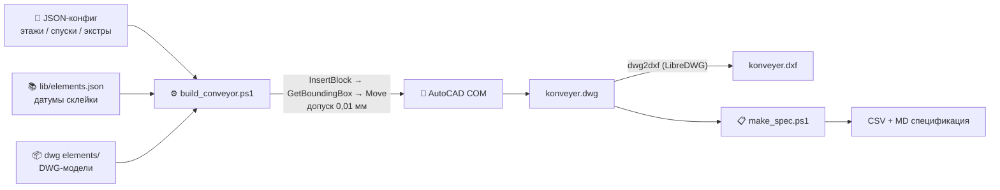

# 🏭 Transporter CAD — конструктор конвейерных систем

> 🇬🇧 [English version](README.md)

**Автоматическая сборка 3D-моделей многоэтажных конвейеров из библиотеки элементов: JSON-конфиг на входе — готовый DWG/DXF и спецификация (BOM) на выходе.**


---

## ✨ Возможности

- **🏗️ Сборка серпантинных конвейеров на N этажей** — секции, горки, трансферы 90°, зоны сортировки и любые сторонние модели расставляются автоматически по JSON-конфигу
- **🎯 Самокоррекция вставок** — каждый элемент после вставки замеряется `GetBoundingBox` и позиционируется повторно с допуском **0,01 мм**; INSBASE, базовые точки и staging-смещения любой новой модели компенсируются автоматически
- **🔗 Авто-анкоринг стыков** — линии-приёмники сами подгоняются торцом к выходной грани горки; вершина горки привязывается к плоскости стола трансфера
- **📋 Спецификация (BOM)** — из любого DWG: CSV (UTF-8, открывается в Excel) + Markdown-сводка по типам элементов, суммарным длинам и линиям этажей
- **📚 Расширяемая библиотека элементов** — `probe_element.ps1` замеряет новую DWG-модель и добавляет её в `elements.json`
- **🖥️ GUI (WPF)** — удобная оболочка: вкладки «Сборка», «Спецификация», «Библиотека», «Схема» (XZ-предпросмотр серпантина)
- **🤖 Скилл для Claude Code** — вся логика зашита в `.claude/skills/transporter-cad`, агент собирает конвейер по текстовой команде («собери серпантин на 4 этажа»)

---

## 🚀 Быстрый старт

### Вариант 1 — GUI (для пользователей)

```bat
Prog\transporter_gui.cmd
```

Запускается окно с четырьмя вкладками:

| Вкладка | Что делает |
|---|---|
| **Сборка** | Этажи, спуски, экстра-элементы → конфиг JSON → `build_conveyor.ps1`, живой лог отчёта |
| **Спецификация** | Запуск `make_spec.ps1` по выбранному DWG → CSV + MD |
| **Библиотека** | Просмотр `elements.json`, probe новых DWG, правка датумов с бэкапом |
| **Схема** | XZ-предпросмотр серпантина до сборки |

### Вариант 2 — CLI

```powershell
# Сборка конвейера по конфигу
powershell -File .claude/skills/transporter-cad/scripts/build_conveyor.ps1 -Config configs/serpentine4.json

# Спецификация по готовому DWG
powershell -File .claude/skills/transporter-cad/scripts/make_spec.ps1 -Dwg konveyer.dwg -Lib lib/elements.json -Out konveyer_spec

# Добавление нового элемента в библиотеку
powershell -File .claude/skills/transporter-cad/scripts/probe_element.ps1 -Dwg "dwg elements/новый.dwg" -Name noviy
```

### Вариант 3 — Claude Code (AI-агент)

Скилл `transporter-cad` подхватывается автоматически. Достаточно написать, например: *«собери конвейер на 3 этажа, спуск на запад, зона сортировки на первом этаже»* — агент составит конфиг, запустит сборку, проверит стыки по bbox и выдаст таблицу размещений.

---

## ⚙️ Как это работает



### Ключевые принципы

1. **Никогда не доверяй первому размещению.** Вставка → замер bbox → коррекция → повторный замер. Это и есть самокоррекция.
2. **Датумы вместо «на глаз».** Точки склейки каждого элемента (вершина горки = плоскость стола трансфера, низ датчиков секции = плоскость этажа и т.д.) хранятся в `elements.json` и откалиброваны по эталонному общему чертежу мм в мм.
3. **Серпантин из коробки.** Этажи друг над другом, спуски чередуются восток/запад, осевые Y-смещения линий (−1083,761 мм) учитываются формулами автоматически.
4. **VERIFY-отчёт.** После сборки скрипт замеряет ВСЕ вставки и пишет строки `JOIN dx=0 dy=0` — любое отклонение > 0,5 мм видно сразу.

---

## 📁 Структура репозитория

```
├── Prog/
│   ├── transporter_gui.cmd              # лаунчер GUI (powershell -STA)
│   └── transporter_gui.ps1              # WPF-оболочка
├── .claude/skills/transporter-cad/      # скилл Claude Code
│   ├── SKILL.md                    # правила, датумы, формулы серпантина
│   ├── scripts/
│   │   ├── build_conveyor.ps1      # сборка конвейера
│   │   ├── make_spec.ps1           # спецификация (BOM)
│   │   ├── probe_element.ps1       # добавление элемента в библиотеку
│   │   └── render3d.ps1            # рендер сверки (XY/XZ/YZ)
│   ├── lib/elements.json           # библиотека элементов + датумы
│   └── configs/                    # примеры конфигов сборки
├── dwg elements/                   # DWG-модели (секция, горка, трансфер…)
│   └── convert/                    # dwg2dxf.exe, dwggrep.exe (LibreDWG)
├── dxf elements/                   # DXF-версии моделей
└── konveyer.dwg / konveyer.dxf     # результат последней сборки
```

---

## 🧩 Пример конфига (серпантин на 4 этажа)

```json
{
  "output": { "dwg": "konveyer4.dwg", "dxf": true },
  "elements_lib": "lib/elements.json",
  "floor_gap": 3000,
  "lines": [
    { "id": "floor4", "z": 9000, "y": 0,         "length": 50000, "element": "section" },
    { "id": "floor3", "z": 6000, "y": -1083.761, "length": 50000, "element": "section" },
    { "id": "floor2", "z": 3000, "y": 0,         "length": 50000, "element": "section" },
    { "id": "floor1", "z": 0,    "y": -1083.761, "length": 30000, "element": "section" }
  ],
  "drops": [
    { "upper": "floor4", "lower": "floor3", "side": "east", "gorka": "gorka", "transfer": "transfer" },
    { "upper": "floor3", "lower": "floor2", "side": "west", "gorka": "gorka", "transfer": "transfer" },
    { "upper": "floor2", "lower": "floor1", "side": "east", "gorka": "gorka", "transfer": "transfer" }
  ]
}
```

`length` растягивает линию посекционно (scale_x), `y` приёмников можно не задавать — авто-анкоринг выставит сам.

---

## 🛠️ Требования

- **Windows 10/11**, PowerShell 5.1+ (запуск `.ps1` с `-ExecutionPolicy Bypass`)
- **AutoCAD** с доступным COM-интерфейсом (скрипты сами поднимают `acad.exe` и ждут регистрации в ROT)
- **LibreDWG** (`dwg2dxf.exe`, `dwggrep.exe`) — бинарники уже лежат в `dwg elements/convert/`
- Для AI-режима — **Claude Code** (скилл в `.claude/skills/`)

> **⚠️ Важно:** если целевой DWG открыт в AutoCAD, `SaveAs` в тот же путь *молча* не сработает — скрипты проверяют лок файла и либо правят на месте, либо сохраняют под новым именем.

---

## 📦 Git LFS

Большие CAD-файлы (`*.dwg`, `*.dxf`, `*.bak`) версионируются через **Git LFS**. После клонирования:

```bash
git lfs install
git lfs pull
```

## 📄 Лицензия

MIT.
